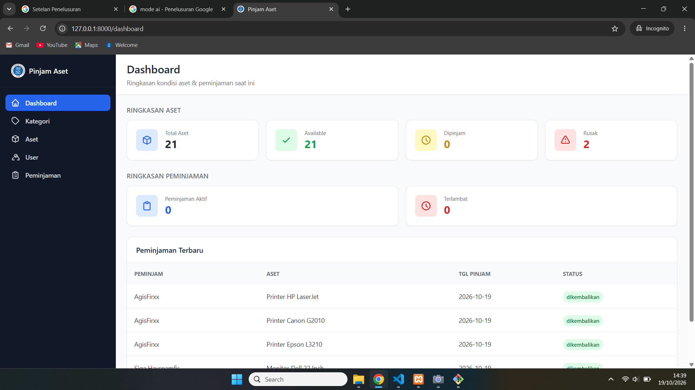
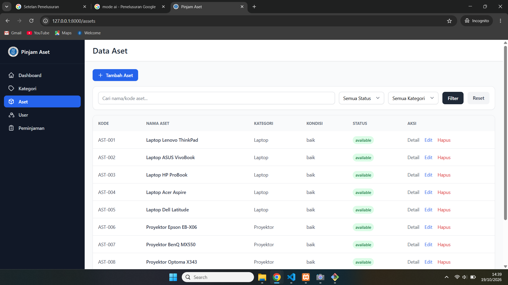
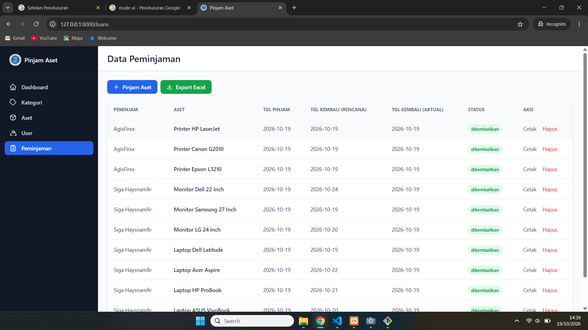
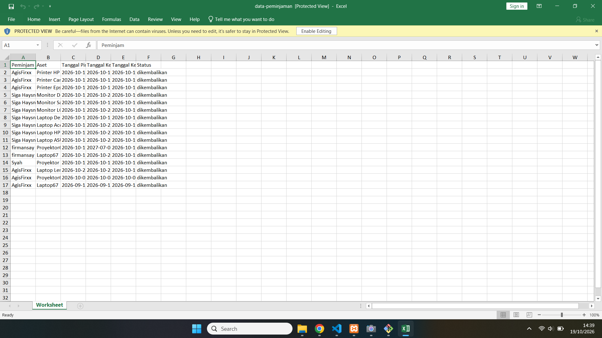

# Pinjam Aset - Sistem Inventaris & Peminjaman Aset Internal Kantor

Aplikasi web untuk mencatat aset kantor (laptop, proyektor, kursi, dll) dan mengelola proses peminjaman oleh karyawan. Dibuat sebagai proyek selama Praktik Kerja Lapangan (PKL).

## Fitur

- **Autentikasi**: login & register (Laravel Breeze)
- **Role pengguna**: Admin dan Karyawan dengan hak akses berbeda
- **Manajemen Kategori & Aset** (admin): CRUD, pencarian, filter status/kategori, dan halaman detail dengan riwayat peminjaman per aset
- **Peminjaman & Pengembalian**: status aset berubah otomatis (available / dipinjam), peminjaman terlambat terdeteksi otomatis
- **Validasi peminjaman**: aset rusak berat atau sedang dipinjam tidak bisa dipinjam, tanggal pinjam tidak boleh di masa lalu
- **Dashboard ringkasan**: total aset, status aset, peminjaman aktif, peminjaman terlambat, dan peminjaman terbaru
- **Notifikasi**: badge jumlah peminjaman terlambat di sidebar
- **Export Excel**: laporan data peminjaman
- **Cetak PDF**: bukti peminjaman per transaksi
- **Manajemen User** (admin): ubah role dan hapus user
- **Pagination** pada tabel data

## Hak Akses

| Fitur | Admin | Karyawan |
|---|---|---|
| Dashboard | Ya | Ya |
| Kategori, Aset, User | Ya | Tidak |
| Lihat semua peminjaman | Ya | Hanya miliknya |
| Pinjam & kembalikan aset | Ya | Ya |

## Tech Stack

- PHP 8.2, Laravel 12
- MySQL
- Blade + Tailwind CSS + Alpine.js
- Laravel Excel (maatwebsite/excel) dan DomPDF (barryvdh/laravel-dompdf)

## Struktur Database

- `users` (name, email, password, role)
- `categories` (nama_kategori)
- `assets` (kode_aset, nama_aset, category_id, kondisi, status, lokasi)
- `loans` (user_id, asset_id, tanggal_pinjam, tanggal_kembali_rencana, tanggal_kembali_aktual, status)

## Cara Instalasi

Prasyarat: PHP 8.2+ (ekstensi `zip` dan `gd` aktif), Composer, Node.js, MySQL (XAMPP/Laragon).

```bash
git clone https://github.com/AgisFirxx/inventaris-aset.git
cd inventaris-aset
composer install
npm install
copy .env.example .env
php artisan key:generate
```

Buat database kosong bernama `inventaris_aset` di phpMyAdmin, lalu edit `.env`:

```
DB_CONNECTION=mysql
DB_HOST=127.0.0.1
DB_PORT=3306
DB_DATABASE=inventaris_aset
DB_USERNAME=root
DB_PASSWORD=
```

Lanjutkan:

```bash
php artisan migrate
php artisan db:seed --class=AssetSeeder
npm run build
php artisan serve
```

Buka `http://127.0.0.1:8000`, lalu register akun. Semua akun baru otomatis berperan **Karyawan**. Untuk menjadikan akun sebagai Admin, jalankan:

```bash
php artisan tinker
```
```php
$user = App\Models\User::where('email', 'email-anda@example.com')->first();
$user->role = 'admin';
$user->save();
```

## Screenshot

| Dashboard | Data Aset |
|---|---|
|  |  |

| Peminjaman | Bukti Peminjaman (PDF) |
|---|---|
|  |  |

## Pengembang

Dibuat oleh **AgisFirxx** dalam rangka Praktik Kerja Lapangan (PKL).